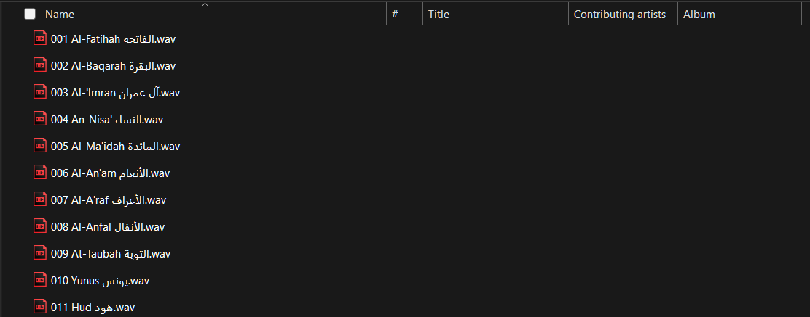
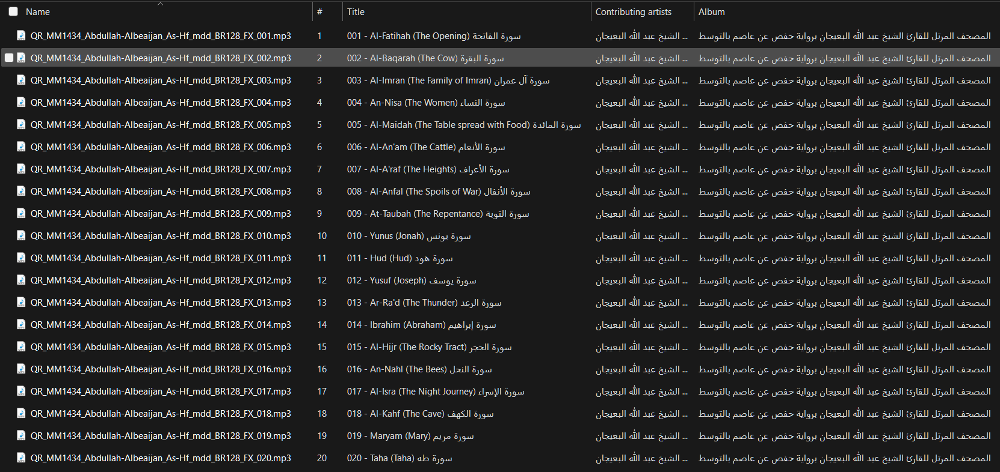
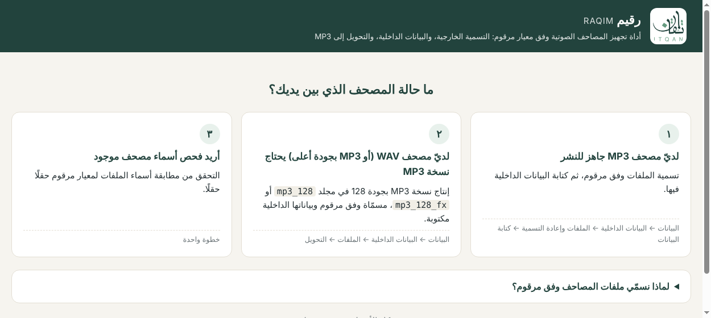
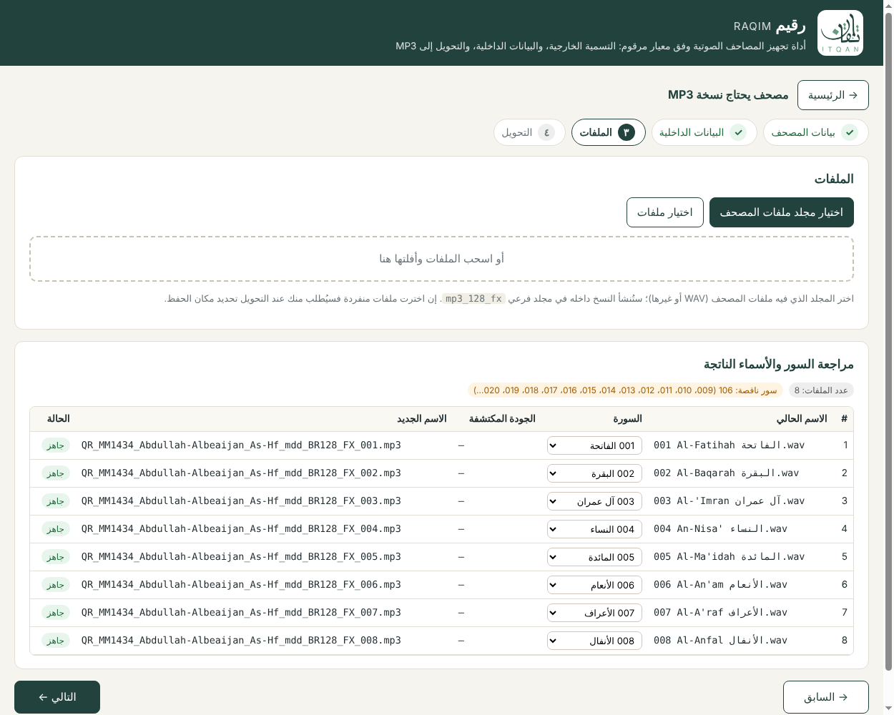
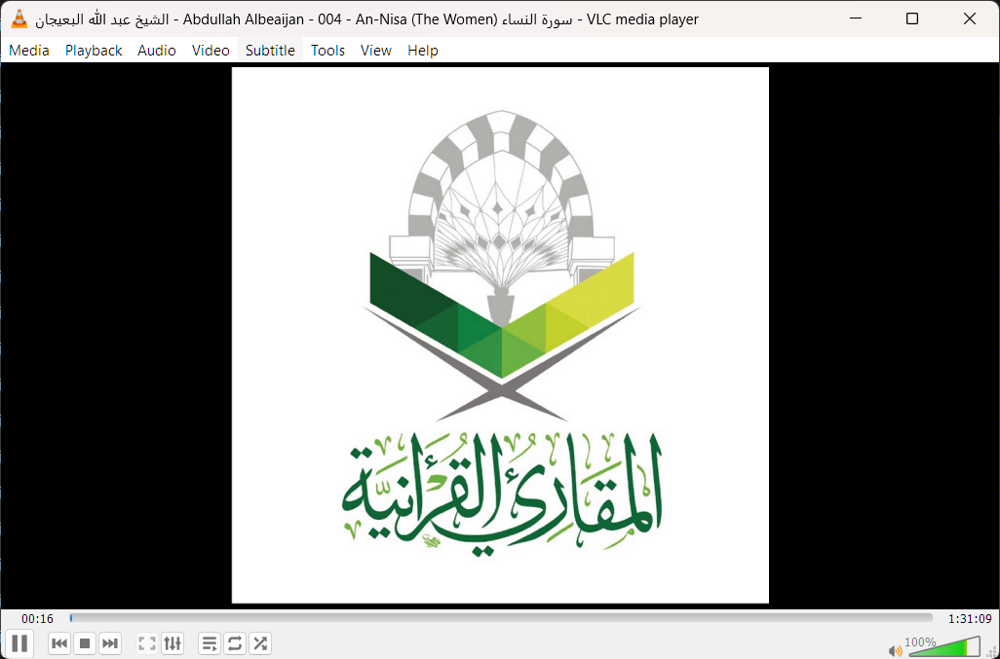

# رقيم: أداة لتجهيز المصاحف الصوتية وفق معيار مرقوم

أحمد شمس · 20 نوفمبر 2026

«رقيم» (RAQIM: Recitation Audio Quran Integrated Manager) أداة مجانية في ملف واحد، تأخذ مصحفًا صوتيًا من 114 ملفًا وتخرجه جاهزًا للرفع على فنار وغيره من الأنظمة: أسماء ملفات مطابقة لمعيار مرقوم، ونسخة MP3 أو M4A بالجودة المطلوبة، وبيانات داخلية موحدة بالعربية.

**ثلاثة برامج في أداة واحدة.** كان تجهيز المصحف للنشر يحتاج إلى ثلاثة برامج منفصلة: برنامج لإعادة تسمية الملفات (التسمية الخارجية)، وبرنامج لكتابة بياناتها (التسمية الداخلية)، وبرنامج لتحويل الصوتيات. ولكل برنامج إعداداته وخطواته، والانتقال بينها يضاعف فرص الخطأ. الأداة تجمع الثلاثة في ملف واحد، ببيانات تُدخَل مرة واحدة وتُستعمل في المراحل كلها، بل تنجز الثلاثة في خطوة واحدة في مسار التحويل: تُنتج النسخة وتسمّيها وتكتب بياناتها معًا. وتُكتب البيانات الداخلية كلها بترميز UTF-16 مع BOM، فتبقى العربية مقروءة سليمة في الأنظمة والمشغلات الشائعة دون رموز غريبة.

**مجانية بالكامل وبلا أي متطلبات.** لا تحتاج إلى تثبيت برامج، ولا إلى رخصة، ولا إلى مفاتيح تفعيل، ولا إلى شراء أي شيء، ولا إلى حساب أو اتصال بالإنترنت. ملف واحد تفتحه في المتصفح فيعمل فورًا، ويمكن نسخه وتمريره لأي فريق أو شريك دون قيود.

## لماذا بنينا هذه الأداة؟

يصلنا المصحف الواحد من القارئ أو الاستوديو بأسماء مثل `001.mp3` أو `سورة البقرة.wav` أو `Dosari_128kbps_002.mp3`، وكل جهة تسمّي على طريقتها. وحين تتعدد المصاحف والروايات وطرق الأداء ونسخ المؤثرات، يصعب على المنصة والمطوّر والمستخدم معرفة ما في الملف من اسمه.

لهذا وضع فريق إتقان معيار **مرقوم** (الدليل الإلزامي القرآني الكلّي الموحد) لتسمية كل ما يُرفع على فنار وغيره من الأنظمة، وفيه جزء خاص بملفات التلاوات. لكن تطبيق المعيار يدويًا على 114 ملفًا لكل مصحف عمل ممل وكثير الأخطاء: رقم سورة بخانتين بدل ثلاث، أو رمز رواية مكتوب خطأ، أو عنوان داخلي لسورة أخرى.

الأداة تقوم بهذا العمل كله آليًا، وتنبّه على الأخطاء قبل وقوعها.

## صيغة اسم ملف التلاوة في مرقوم

حسب البند 12.4 من مرقوم، يتكون اسم ملف التلاوة من حقول تفصل بينها شرطة سفلية `_`، مثل:

```
QR_SC1447_Ibrahim-Addosari_As-Hf_mdd_BR128_FX_001.mp3
```

| الحقل            | مثال | معناه                               | ملاحظات                                                                                                                     |
|-----------------------------------------|-----------------------------|------------------------------------------------------------|----------------------------------------------------------------------------------------------------------------------------------------------------|
| النوع            | `QR`                        | تلاوة صوتية                         | ثابت                                                                                                                        |
| المشروع والسنة   | `SC1447`                    | المركز السعودي للتلاوات، إصدار 1447 | المشاريع: `SC` المركز السعودي للتلاوات، `TH` تحبير القراءات العشر، `MK` جمعية مكنون، `QQ` قراءات القرآن. السنة اختيارية     |
| القارئ           | `Ibrahim-Addosari`          | اسم القارئ بالإنجليزية              | حرف كبير أول كل جزء، وبين الأجزاء شرطة عادية                                                                                |
| القراءة والرواية | `As-Hf`                     | حفص عن عاصم                         | 20 رمزًا للروايات العشرين، مثل `Na-Qa` قالون و`Na-Wa` ورش                                                                    |
| نمط الأداء       | `mdd`                       | التوسط                              | `qsr` قصر، `wmim` صلة ميم الجمع، `smim` سكونها، `jmea` جمع القراءة. اختياري، ولا يجتمع القصر والتوسط، ولا صلة الميم وسكونها |
| الجودة           | `BR128`                     | 128 kbps                                                   | `BR64` أو `BR128` أو `BR256` أو `BR320`                                                                                     |
| المؤثرات         | `FX`                        | نسخة بالمؤثرات                      | يُحذف الحقل في النسخة بدون مؤثرات                                                                                            |
| رقم السورة       | `001`                       | الفاتحة                             | ثلاث خانات دائمًا حتى تترتب الملفات في كل الأنظمة                                                                            |

لا يحتاج المستخدم إلى حفظ هذه الرموز: يختار الرواية والأداء من قوائم بالعربية، والأداة تكتب الرموز.

## لماذا نسمّي الملفات بهذه الطريقة؟

الاسم وفق مرقوم بطاقة تعريف للملف: يكفي أن تقرأه لتعرف ما فيه، دون أن تفتحه أو تستمع إليه.

- **اسم فريد لا يتكرر:** ملف الفاتحة لكل قارئ ورواية وطريقة أداء وجودة ونسخة مؤثرات له اسم يخصه، فتجتمع مئات المصاحف في نظام واحد دون أن يحلّ ملف محل آخر.

- **ترتيب صحيح في كل الأنظمة:** رقم السورة بثلاث خانات، فتأتي 002 قبل 010، لا بعدها كما يحدث مع 2 و10.

- **بحث وفرز بأي حقل:** كل مصاحف ورش (`Na-Wa`)، أو كل نسخ 128، أو كل نسخ المؤثرات، ببحث بسيط في الاسم.

- **قراءة آلية:** الحقول مفصولة بـ `_` وبترتيب ثابت، فيستطيع فنار أو أي برنامج استخراج القارئ والرواية والسورة من الاسم وملء بيانات المحتوى تلقائيًا.

- **اسم آمن تقنيًا:** حروف لاتينية وأرقام بلا مسافات، فلا يتشوه في الروابط والخوادم وشبكات التوزيع وسطر الأوامر.

- **يبقى إن ضاعت البيانات الداخلية:** بعض المنصات تحذف بيانات الملف الداخلية، أما الاسم فينتقل معه أينما ذهب.

- **تتبّع المصدر والإصدار:** رمز المشروع والسنة يفرّقان بين تسجيلين لقارئ واحد.

- **فحص آلي للجودة:** لأن الصيغة ثابتة يمكن التحقق منها ببرنامج قبل النشر.

- **لغة مشتركة بين الفرق:** المنتج والمدقق والمطوّر والشريك يفهمون الاسم بالطريقة نفسها.

**مثال على أهم فائدة: الحماية من الكتابة فوق الملفات (Overwrite).** لو كانت ملفات المصاحف مرقّمة فقط (`001.mp3` … `114.mp3`)، ثم نسخ أحدهم مصحفًا إلى مجلد مصحف آخر على السيرفر بالخطأ، لحلّت الملفات الجديدة محل الأصلية وضاع مصحف كامل دون أن ينتبه أحد. أما مع أسماء مرقوم فلا يتطابق اسمان من مصحفين مختلفين، فيبقى الملفان معًا، ويظهر الخطأ بوضوح ويُصلح بنقل الملفات إلى مكانها.

**نموذج من مصحف حقيقي قبل التسمية وبعدها.** قبل: ملفات WAV بأسماء تخلط العربية باللاتينية وفيها مسافات وعلامات، وأعمدة العنوان والقارئ والألبوم فارغة.



بعد: أسماء مرقوم موحدة مرتبة، والعنوان ورقم المقطع والقارئ والألبوم مكتوبة بالعربية سليمة في متصفح ملفات Windows.



## صفحة البداية: ثلاثة مسارات بحسب حالة المصحف

تفتح الأداة على سؤال واحد: «ما حالة المصحف الذي بين يديك؟». وبحسب الجواب تأخذ المستخدم في مسار من خطوات مرقّمة، لا يرى في كل خطوة إلا ما يحتاجه.



| المسار               | متى يُستعمل                                            | الخطوات                                                                     | الناتج                                                      |
|---------------------------------------------|------------------------------------------------------------------------------|----------------------------------------------------------------------------------------------------|------------------------------------------------------------------------------------|
| مصحف MP3 جاهز للنشر  | الملفات MP3 بالجودة المطلوبة وتحتاج تسمية وبيانات فقط | بيانات المصحف ← البيانات الداخلية ← الملفات وإعادة التسمية ← كتابة البيانات | الملفات نفسها مسمّاة وفيها بياناتها                          |
| مصحف يحتاج نسخة MP3  | الأصل WAV، أو MP3 بجودة أعلى من المطلوب               | بيانات المصحف ← البيانات الداخلية ← الملفات ← التحويل                       | مجلد `mp3_128` أو `mp3_128_fx` فيه نسخ مسمّاة وفيها بياناتها |
| فحص أسماء مصحف موجود | للتأكد من مصحف مسمّى من قبل                            | خطوة واحدة                                                                  | قائمة بالمخالفات حقلًا حقلًا                                  |

في كل مسار يظهر شريط خطوات أعلى الصفحة، ولا ينتقل المستخدم إلى الخطوة التالية حتى يكتمل المطلوب، كاسم القارئ أو الملفات. ومن يعرف الأداة جيدًا يستطيع عرض كل الأقسام في صفحة واحدة من رابط أسفل صفحة البداية.

وفي مسار التحويل تُعبّأ البيانات قبل التحويل لا بعده، لأن الأداة تسمّي النسخة الناتجة وتكتب بياناتها في اللحظة نفسها، فلا يمرّ المستخدم على الملفات مرتين.

## المسار الأول: مصحف MP3 جاهز للنشر

يدخل المستخدم بيانات المصحف مرة واحدة، ثم يختار مجلد الملفات، فتبني الأداة الأسماء الجديدة للملفات الـ114 وتعرضها في جدول للمراجعة قبل أي تغيير.

**التعرّف على السورة من الاسم القديم.** تقرأ الأداة اسم كل ملف وتستنتج السورة بهذا الترتيب:

1.  رقم من ثلاث خانات مثل `002`، وتتجاهل أرقامًا كالجودة `128`.

2.  اسم عربي مثل «سورة البقرة» أو «آل عمران»، مع تجاهل التشكيل واختلاف الهمزات والتاء المربوطة.

3.  اسم إنجليزي مثل `Al-Kahf` أو `Ya-Seen`.

4.  أي رقم آخر بين 1 و114، ويُعلَّم هذا بـ«تحقّق من السورة».

ويمكن تصحيح أي سورة يدويًا من قائمة في الجدول.

جدول المراجعة بعد اختيار الملفات: الاسم الحالي، والسورة التي تعرّفت عليها الأداة، والاسم الجديد، والحالة، وفوقه عدد الملفات والسور الناقصة.



**التنبيهات قبل التنفيذ:**

- سورة لم تُعرف أو مكررة: لا تُعاد تسمية الملف حتى تُصحّح.

- السور الناقصة من المصحف بأرقامها.

- جودة الملف الفعلية: تقرؤها الأداة من داخل ملف MP3، وتنبّه إذا كان الملف 64 والاسم سيقول `BR128`، أو إذا كانت جودته متغيرة (VBR).

**التنفيذ.** عند اختيار مجلد تُعاد تسمية الملفات في مكانها بضغطة واحدة، ولا تُستبدل ملفات موجودة بالاسم نفسه. ومن اختار ملفات منفردة ينزّل ملف أوامر `.bat` يشغّله داخل المجلد على Windows. ويمكن أيضًا تنزيل جدول CSV بالأسماء القديمة والجديدة.

بعدها تنتقل الأداة إلى كتابة البيانات الداخلية في الملفات نفسها، كما يأتي في قسم البيانات الداخلية.

## المسار الثاني: مصحف يحتاج نسخة MP3 أو M4A

تحوّل الأداة المصحف إلى MP3 بالجودة المختارة (128 افتراضيًا)، وتحفظ النسخ في مجلد فرعي داخل مجلد المصحف:

- `mp3_128` للنسخة بدون مؤثرات.

- `mp3_128_fx` للنسخة بالمؤثرات.

ويتغير اسم المجلد مع الجودة، فيصبح مثلًا `mp3_64` أو `mp3_320_fx`. وكل ملف يخرج باسم مرقوم وبياناته الداخلية مكتوبة، فلا يحتاج إلى خطوة تسمية بعد التحويل.

**جودة الترميز.** يستعمل رقيم مرمِّز LAME الأصلي (الإصدار 3.100)، وهو المرمِّز المرجعي لصيغة MP3، مبنيًا داخل الأداة فيعمل دون إنترنت. يرمّز بجودة ثابتة (CBR)، ومخزن البتات فيه مفعّل، ويأخذ الصوت بدقته الكاملة دون تقليصه إلى 16 بت، ويبقي تردد الملف كما في الأصل. ويختار المستخدم بين إعدادين:

|                                            | أعلى دقة ممكنة (الافتراضي)                            | قياسي                                                 |
|--------------------------------------------|------------------------------------------------------------------------------|------------------------------------------------------------------------------|
| مستوى الدقة في LAME | 0، وهو الأعلى                                         | 2، وهو الموصى به في وثائق LAME                        |
| الاستريو            | استريو مشترك (Joint Stereo) دائمًا، حتى للمصدر الأحادي | استريو مشترك (Joint Stereo) دائمًا، حتى للمصدر الأحادي |
| السرعة              | أبطأ من القياسي بنحو مرتين إلى 3 مرات                 | أسرع                                                  |

والجودة المختارة (128 مثلًا) وحجم الملف واسم المجلد الناتج واحدة في الإعدادين. وما يخرج بـ«أعلى دقة» هو أفضل ملف يستطيع LAME إنتاجه بالجودة المختارة، سواء كانت 64 أو 128 أو 256 أو 320.

**نسخة M4A (AAC).** ويستطيع رقيم إنتاج نسخة بصيغة M4A بالجودات نفسها (64 أو 128 أو 256 أو 320)، في مجلد مثل `m4a_128` أو `m4a_128_fx`. يستعمل لذلك مرمِّز Fraunhofer FDK AAC، من أجود مرمِّزات AAC المفتوحة، مبنيًا داخل الأداة كذلك. يرمّز بصيغة AAC-LC بجودة ثابتة وبأعلى إعداداته (Afterburner)، استريو دائمًا، ويضبط مدة الملف بدقة فلا تزيد النسخة صمتًا في أولها. ولا يُنتج الـM4A إلا من مصدر عالي الجودة: ملف WAV، أو MP3 بجودة 256 أو 320، وتُتخطّى المصادر الأقل جودة حتى لا تتراكم خسارة الضغط مرتين. وتُكتب بياناته الداخلية وصورة الغلاف داخل الملف أثناء التحويل.

**تزمين واحد لكل الجودات.** يعوّض رقيم في نسخة M4A تأخير المرمِّز بدقة داخل الملف، فيبدأ صوتها في اللحظة نفسها التي يبدأ فيها ملف WAV الأصلي، دون زيادة أو نقص ولو عيّنة صوتية واحدة، وفي كل الجودات. وقد تحققنا من ذلك قياسًا في الجودات 64 و128 و256 و320. لذلك يصلح تزمين الآيات المعمول على ملف WAV لكل نسخ M4A الناتجة منه، ولا حاجة إلى تزمين كل نسخة على حدة. أما ملفات MP3 فيضيف مرمِّزها صمتًا قصيرًا في أولها، وتختلف المشغلات في التعامل معه وفي دقة الانتقال داخل الملف، فيحتاج كل إصدار منها إلى تزمين خاص به.

**ما تقبله الأداة:**

- WAV بدقة 8 أو 16 أو 24 أو 32 بت، مع قراءة متدفقة لا تملأ الذاكرة حتى مع البقرة.

- MP3 بأي جودة. وإن كانت جودته هي المطلوبة أصلًا يُنسخ كما هو دون إعادة ضغط، حفاظًا على جودته.

- ترددات مثل 96 أو 88.2 كيلوهرتز تُحوَّل تلقائيًا بمحوِّل LAME عالي الجودة إلى 48 أو 44.1.

- صيغ M4A وFLAC وOGG تعمل أيضًا، لكنها تستهلك ذاكرة أكبر مع السور الطويلة.

**أثناء التحويل:**

- تحوّل الأداة حتى ثلاثة ملفات في وقت واحد بحسب قوة الجهاز، وتعرض نسبة التقدم لكل ملف.

- الملفات الأصلية لا تُمسّ.

- يمكن إيقاف التحويل في أي لحظة، وعند إعادة تشغيله يتخطى الملفات التي اكتملت ويكمل الباقي.

**بعد التحويل.** تعرض الأداة مكان الملفات بالضبط، مثل «تلاواتي 1448 ← mp3_128»، وزر «عرض الملفات الناتجة وتشغيلها» الذي يسرد الملفات بأحجامها ويشغّل أيًا منها داخل الأداة، فيتأكد المستخدم من الجودة دون أن يغادرها.

التحويل يجري داخل المتصفح، وسرعته بحسب قوة الجهاز والإعداد المختار. ويستغرق «أعلى دقة» وقتًا أطول من «قياسي»، فلمصحف كامل يُفضّل استعمال أقوى جهاز متاح. وتعالج الأداة عدة ملفات معًا، كل ملف على نواة مستقلة من المعالج، ويحدد المستخدم عددها أو يتركه تلقائيًا بحسب أنوية جهازه. في تجربة فعلية بإعداد «أعلى دقة» تحوّل مصحف كامل في 26 دقيقة بمعالجة 6 ملفات معًا، مقابل أكثر من 35 دقيقة بثلاثة ملفات.

## البيانات الداخلية للملفات

تكتب الأداة في كل ملف البيانات التي يعرضها المشغّل ومتصفح الملفات، وفق البند 12.5 من مرقوم. يُدخل المستخدم اسم القارئ بالعربية، والأداة تقترح الباقي ويمكن تعديله.

| الحقل     | ما يُكتب فيه                                               | مثال                                                                 |
|----------------------------------|----------------------------------------------------------------------------------|---------------------------------------------------------------------------------------------|
| Title                            | عنوان السورة الثابت في كل التلاوات                        | 103 - Al-Asr (The Time) سورة العصر                                                          |
| Track                            | رقم السورة من 114                                         | 103/114                                                                                     |
| Author / Artist                  | اسم القارئ بالعربية والإنجليزية                           | يوسف بن سعيد الدوسري - Yusof Addosari                                |
| Album                            | اسم المصحف، يُبنى من الرواية والأداء                       | المصحف المرتل للقارئ يوسف بن سعيد الدوسري برواية حفص عن عاصم بالتوسط |
| Composer / Copyright / Publisher | الناشر، يُملأ من رمز المشروع                               | المركز السعودي للتلاوات                                              |
| Link                             | رابط إتقان                                                | https://itqan.dev                                                                           |
| Cover                            | شعار الناشر، مع تنبيه إن لم يكن مربعًا أو كانت دقته منخفضة | —                                                                    |
| Comment وYear وGenre             | اختيارية                                                  | Quran                                                                                       |

**عناوين ثابتة للسور.** عناوين السور الـ114 مأخوذة من ملف أسماء السور المعتمد في مرقوم (الأسماء الإنجليزية من ترجمة الدكتور محسن خان والشيخ تقي الدين الهلالي)، وهي محفوظة داخل الأداة، فتكون واحدة في كل المصاحف.

**كل البيانات النصية بترميز UTF-16 مع BOM.** تُكتب البيانات بمعيار ID3v2.3، وكل حقل نصي فيها (العنوان والقارئ والألبوم والناشر والتعليق وغيرها) بترميز UTF-16 مسبوقًا بعلامة ترتيب البايتات (BOM). هذا الترميز تقرؤه كل المشغلات والأنظمة الشائعة: متصفح ملفات Windows وWindows Media Player وiTunes وVLC ومشغلات السيارات والجوال. أما UTF-8 فهو جزء من ID3v2.4 فقط، وكثير من المشغلات لا يدعمه، فيظهر النص العربي رموزًا غريبة. وحقل الرابط وحده بحروف لاتينية بحسب المعيار نفسه، لأن الروابط لاتينية أصلًا. أما ملفات M4A فتُكتب بياناتها بمعيار MP4 (iTunes) وترميز UTF-8 الذي يفرضه هذا المعيار، وتقرؤها المشغلات نفسها بالعربية سليمة.

وهذا ملف من المصحف نفسه في مشغّل VLC: اسم القارئ بالعربية والإنجليزية وعنوان السورة في شريط العنوان، وشعار الناشر ظاهر بوصفه صورة الألبوم.



**علامات Sound Forge باقية.** إذا كان في الملف علامات توقيت أضافها Sound Forge فهي تبقى كما هي، وتُستبدل باقي البيانات القديمة بالجديدة. والصوت نفسه لا يتغير.

تحفظ الأداة هذه البيانات مع الصورة في المتصفح، فلا تُعاد كتابتها في المرة التالية على الجهاز نفسه.

## المسار الثالث: فحص أسماء مصحف موجود

يلصق المستخدم أسماء الملفات أو يختار الملفات، فتفحص الأداة كل اسم حقلًا حقلًا وتبيّن موضع الخطأ بالضبط. مثال ذلك الاسم:

```
QR_SC1447_ibrahim addosari_As-Hf_mdd_BR128_FX_1.mp3
```

تظهر فيه ثلاثة أخطاء:

- اسم القارئ بحروف صغيرة وفيه مسافة بدل الشرطة.

- رقم السورة خانة واحدة بدل ثلاث.

- الاسم يحتوي مسافات.

وتفحص الأداة كذلك أن رمز الرواية من الرموز العشرين المعتمدة، وأن رموز الأداء والجودة من القائمة، وأن الاسم لا يحمل حقولًا زائدة بعد رقم السورة. وهذا يحقق ما يطلبه مرقوم من «فحوص آلية لامتثال التسمية».

## المتطلبات والخصوصية والحدود

الأداة ملف HTML واحد يُفتح بالنقر المزدوج، بلا تثبيت وبلا إنترنت. مرمِّز LAME الأصلي (المرمِّز المرجعي لصيغة MP3) وشعار إتقان وأسماء السور كلها داخل الملف.

| البيئة                | التسمية والفحص                     | إعادة التسمية المباشرة والتحويل والبيانات الداخلية |
|----------------------------------------------|-----------------------------------------------------------|---------------------------------------------------------------------------|
| Chrome أو Edge على Windows أو macOS أو Linux | نعم                                | نعم                                                |
| Firefox أو Safari                            | نعم، مع تنزيل ملف `.bat` وجدول CSV | لا                                                 |
| الجوال والآيباد       | لا                                 | لا                                                 |

- **الخصوصية:** الملفات لا تغادر الجهاز، فكل المعالجة تجري داخل المتصفح.

- **الأصول آمنة:** التحويل ينشئ نسخًا جديدة، وكتابة البيانات لا تغيّر الصوت.

- **فتح الملف:** يُفتح من مجلد على الجهاز، لا من معاينة البريد أو Google Drive.

- **الإعدادات:** تُحفظ في متصفح الجهاز الذي استُعمل، ولا تنتقل إلى جهاز آخر.

- **السرعة:** التحويل أبطأ من البرامج المتخصصة، وقد يستغرق مصحف كامل من نصف ساعة إلى ساعة بحسب الجهاز.

## ابدأ في خمس خطوات

1.  احفظ ملف الأداة على جهازك وافتحه في Chrome أو Edge.

2.  اختر حالة مصحفك من صفحة البداية.

3.  عبّئ بيانات المصحف والبيانات الداخلية، واختر صورة شعار الناشر.

4.  اختر مجلد الملفات، وراجع الجدول وصحّح ما تنبّه عليه الأداة.

5.  نفّذ إعادة التسمية وكتابة البيانات، أو التحويل، ثم ارفع الملفات على فنار أو أي نظام آخر.

ننصح بتجربة كل مسار أولًا على نسخة من مجلد صغير فيه سور قليلة، والاستماع للناتج قبل تشغيله على مصحف كامل.

## دعوة لتوحيد تسمية ملفات التلاوات

رقيم ليس أداة داخلية لفريق واحد. هو دعوة لكل العاملين في الحقل القرآني — جهات التسجيل، والمراكز القرآنية، ومطوّري التطبيقات والمنصات — إلى الاجتماع على نظام واحد لتسمية ملفات التلاوات.

حين تتبنّى الجهات المختلفة المعيار نفسه، ينتقل المصحف من جهة إلى أخرى دون إعادة تسمية، وتقرأ التطبيقات الملفات آليًا أيًا كان مصدرها، ويُبنى على هذه الملفات ما يخدم التقنيات القرآنية من مشغلات وتطبيقات تعليمية وأبحاث دون جهد مكرر. والأداة مجانية ومفتوحة للجميع، ليكون تطبيق المعيار في متناول كل من يريده.

## نقاط مفتوحة للنقاش

بعض ما في معيار مرقوم يحتاج إلى قرار، ونرحب بآرائكم فيه:

- **صيغة اسم الألبوم:** الأداة تقترح «المصحف المرتل للقارئ … برواية …»، وهي قابلة للتعديل.

جرّبوا الأداة على مصاحفكم، وشاركونا ما تجدونه من أخطاء أو مقترحات في مجتمع إتقان.

يمكن تحميل الأداة من [هـــنــــــــــــــــــــــــــــــــــــــــــــــــــــــــــــــــــــــــــــــــــــــــــــــــــــــــــــــــــــــــــــــــــا](https://drive.google.com/file/d/1rrzRvLqzpilHFtEYKiPnXtbd13QXbopQ/view?usp=sharing)
